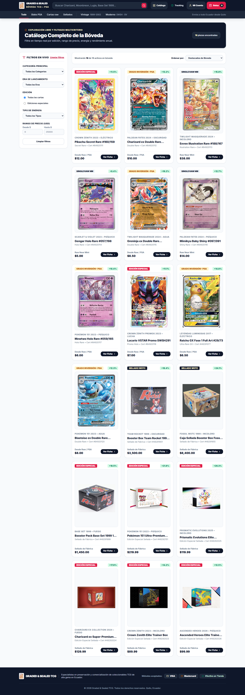
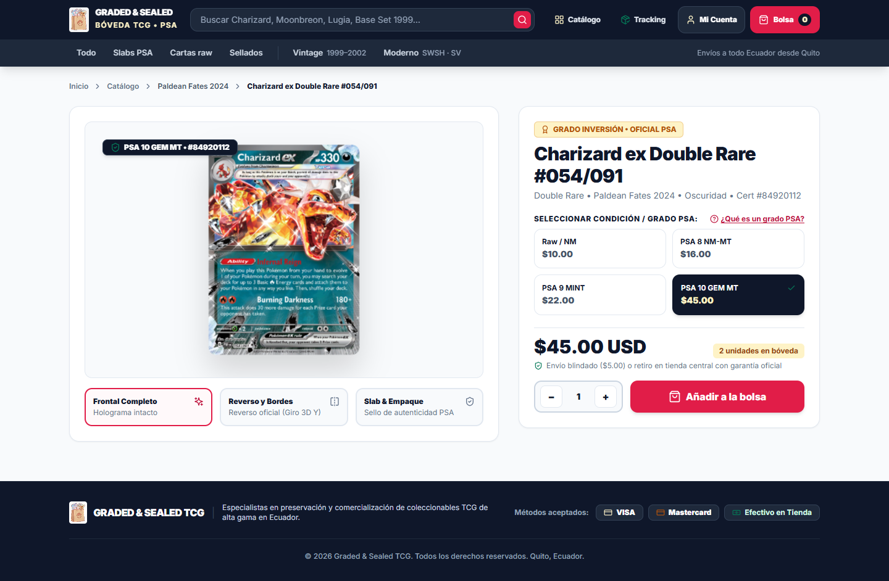
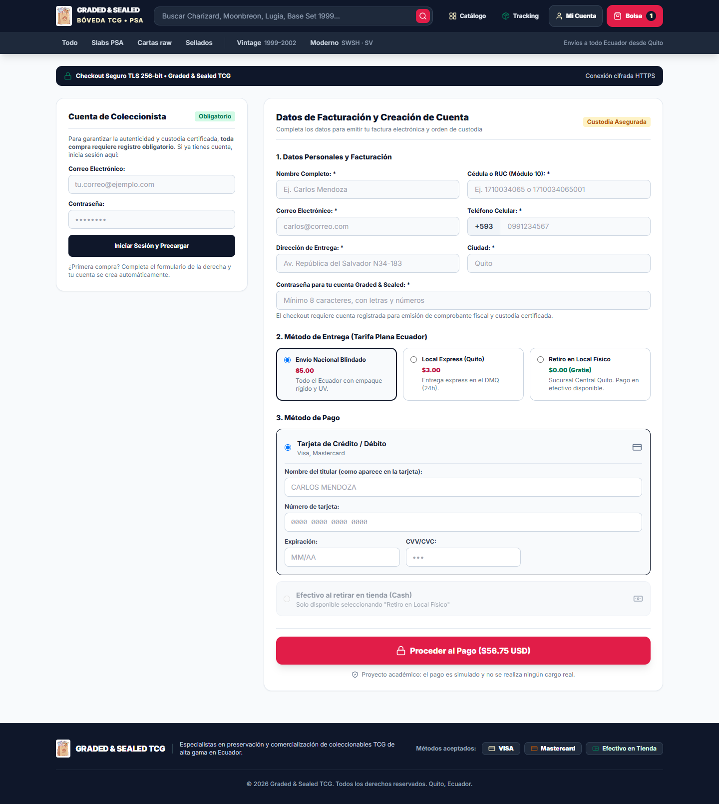

# Graded & Sealed TCG

Tienda online de cartas Pokémon: singles raw, slabs certificados PSA, producto sellado y sets.
Proyecto académico de la materia Interacción Humano-Computador (PUCE). No tiene fines comerciales.

> Pokémon y sus marcas pertenecen a Nintendo, Creatures Inc. y GAME FREAK.

## Funcionalidades

- Catálogo con filtros por categoría, era, grado PSA, energía y precio.
- Ficha de producto con visor 3D de la carta o de la caja sellada.
- Bolsa de compras con control de stock y opción de deshacer.
- Checkout con validación de datos y tarjetas de prueba.
- Registro e inicio de sesión con Supabase Auth.
- Perfil con historial de órdenes y seguimiento de pedidos.
- Búsqueda en la bóveda y en la API pública de Pokémon TCG.

## Stack

- **Frontend:** HTML5, JavaScript (ES6+) sin frameworks, Tailwind CSS y Lucide Icons por CDN.
- **Backend:** Supabase (PostgreSQL, Auth y Row Level Security).
- **Tests:** `node:test`, el runner que viene con Node.js.

## Estructura

```
index.html        Página de inicio
pages/            Resto de páginas (catálogo, producto, carrito, checkout, login, perfil, seguimiento...)
css/              Estilos propios
js/
  app.js          Lógica común: sesión, navbar, carrito
  data.js         Catálogo base
  state.js        Estado global (Store)
  validators.js   Validación de formularios
  services/       Cliente de la API de Pokémon TCG
  views/          Un script por página
  db/             Esquema SQL, funciones RPC, seed y cliente de Supabase
assets/img/       Logo, iconos, cartas, sellados y sobres
tests/            Pruebas unitarias y de integración
tools/            Scripts para regenerar el seed y las caras de las cajas
docs/             Documentación del proyecto y capturas
```

## Cómo ejecutarlo

Las páginas cargan scripts y datos con rutas relativas, así que hay que servirlas desde un servidor local
(abrir el HTML directamente con `file://` no funciona). Desde la raíz del proyecto:

```bash
python -m http.server 5500
```

Luego abre <http://localhost:5500>.

La conexión a Supabase está en `js/db/supabase-config.js` y solo usa la clave pública (*publishable key*).
Para crear la base de datos desde cero, ejecuta en el editor SQL de Supabase `js/db/schema.sql`,
luego `js/db/funciones_rpc.sql` y por último `js/db/seed_catalogo.sql`.

Las tarjetas de prueba para el checkout están en [docs/tarjetas-de-prueba.md](docs/tarjetas-de-prueba.md), y la guía para reponer stock en [docs/guia-inventario.md](docs/guia-inventario.md).

## Tests

Se necesita Node.js 18 o superior:

```bash
node --test tests/*.test.mjs
```

## Capturas

| Inicio | Catálogo |
|---|---|
|  |  |

| Ficha de producto | Checkout |
|---|---|
|  |  |

Hay más capturas, en escritorio y móvil, en [docs/capturas/](docs/capturas/).
